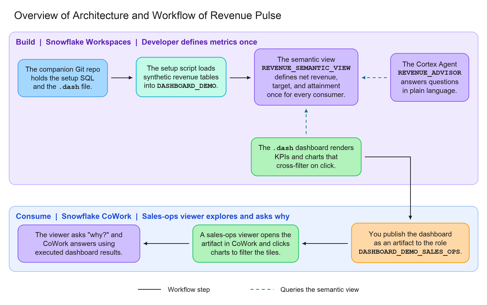
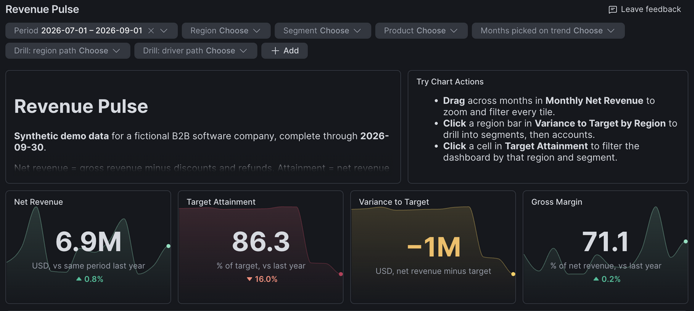
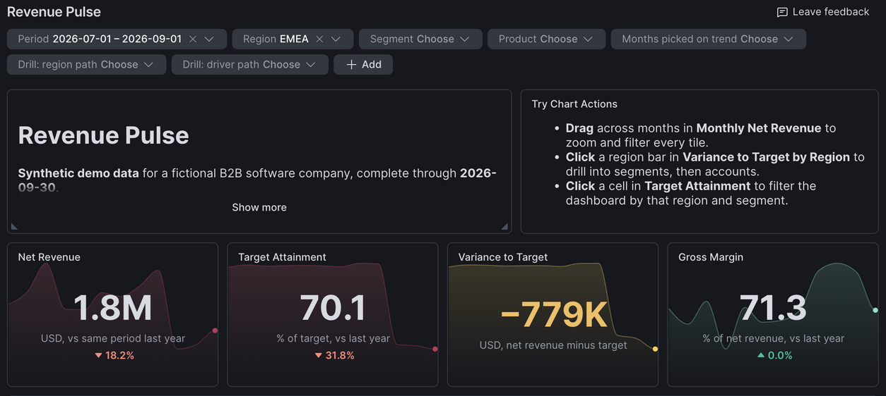
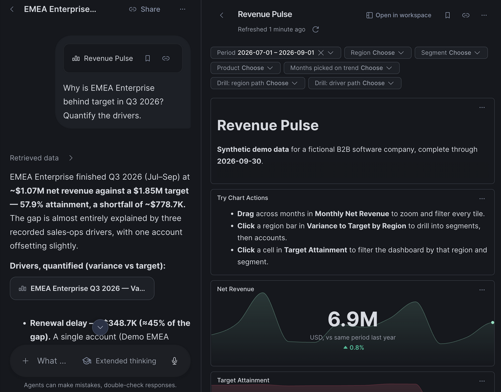

author: Chanin Nantasenamat
id: build-a-revenue-dashboard-with-snowflake-workspaces
categories: snowflake-site:taxonomy/solution-center/certification/quickstart, snowflake-site:taxonomy/product/analytics, snowflake-site:taxonomy/product/ai
language: en
summary: Get started with Snowflake Dashboards 2.0 using step-by-step Cortex Code prompts to build, refine, and check a revenue dashboard, then publish it and explore it in CoWork.
environments: web
status: Published
feedback link: https://github.com/Snowflake-Labs/sfquickstarts/issues
fork repo link: https://github.com/sfc-gh-cnantasenamat/build-a-revenue-dashboard-with-snowflake-workspaces

# Getting Started with Snowflake Dashboards 2.0

## Overview

It's Monday morning and revenue is behind target. The BI dashboard says attainment is 86%, the AI assistant says 84%, and the sales-ops spreadsheet says something else. Each tool has its own copy of the metric logic, so the team spends the meeting reconciling numbers instead of asking why the quarter is slipping. Even once the numbers agree, finding the cause means paging through a multi-page dashboard and drilling down filter by filter.

To work through that morning revenue check, you'll use a sample dataset with a shortfall to investigate.

All data is synthetic: a fictional B2B software company with 54 accounts, 3 product lines, and 24 months of revenue through September 30, 2026. The data contains a story. Q3 2026 net revenue is barely up (0.8%) year over year and $1.09M behind target. EMEA Enterprise is the largest single miss, and APAC is behind too.

The task is to trace that shortfall from the company-wide total to the regions, accounts, and recorded drivers behind it. You'll need a shared overview for the daily check and a way to ask follow-up questions with a consistent basis for comparison.

This guide brings the metric definitions, the AI assistant, and the dashboard together in Snowflake through **Revenue Pulse**, a workflow with three connected parts:

1. **An AI assistant powered by a [Cortex Agent](https://docs.snowflake.com/en/user-guide/snowflake-cortex/cortex-agents).** It answers plain-language revenue questions by turning them into SQL against a semantic view. That supports individual questions, but the team also needs a shared view to check every morning.
2. **A single-page dashboard built with [Dashboards 2.0](https://docs.snowflake.com/en/LIMITEDACCESS/cowork-dashboards).** You use Cortex Code, guided by your natural-language instructions, to build that daily view with KPIs, trends, and variance breakdowns.
3. **A shared [semantic view](https://docs.snowflake.com/en/user-guide/views-semantic/overview) queried by both.** It defines revenue metrics such as net revenue, target, and attainment, the dimensions used to slice them, and how the underlying tables join. Those explicit definitions let readers explore the data through dashboard filters or agent questions without reconstructing the joins and calculations themselves. Both use the same metric definitions; compare results using the same period and filters.

Finally, you'll publish the dashboard as an artifact shared with a sales-ops role, click its charts to filter the results, and ask follow-up "why" questions about those results in [Snowflake CoWork](https://docs.snowflake.com/en/user-guide/snowflake-cortex/snowflake-cowork).

### When to Use Dashboards 2.0
Snowflake gives you several ways to present data, and each fits a different job:

- **HTML reports** suit one-off narrative analyses that are snapshots.
- **Streamlit** and **App Runtime** are for interactive tools and production apps, and they take more code to build and maintain.
- **Dashboards 2.0** sits in between. It is built for recurring KPI monitoring on live, governed queries, with filters, drilldown, and conversational follow-up, at a low build cost.

A morning revenue check fits that last description, so this guide uses a dashboard.


### What You'll Learn
- How to use the Snowsight Cortex Code `/dashboard` skill and refine a dashboard one prompt at a time
- How to model revenue, targets, and margin as a semantic view with additive metrics
- How to create a Cortex Agent with a Cortex Analyst tool over that semantic view
- How to check generated tile SQL, filters, and totals against a reproducible reference
- How a native `.dash` file holds the dashboard's tiles, filters, layout, and SQL datasources
- How to publish a dashboard as an artifact to a single role, with caller's rights
- How to ask follow-up questions about a dashboard in CoWork, and keep recorded drivers separate from hypotheses

### What You'll Build
An end-to-end revenue workflow in which every number comes from one definition:

- **A semantic view** (`REVENUE_SEMANTIC_VIEW`) that defines net revenue, target, variance, and attainment once, on top of synthetic revenue tables.
- **A Cortex Agent** (`REVENUE_ADVISOR`) that answers plain-language revenue questions by querying that semantic view.
- **A "Revenue Pulse" dashboard**, built as a `.dash` file in Snowflake Workspaces, that queries the same semantic view. It has four KPI sparklines, a revenue trend, region and segment breakdowns, a driver donut, a variance waterfall, and account details. The top-right **Try Chart Actions** tile explains the available interactions.
- **A shared artifact**: you publish the dashboard as an artifact and share it with a sales-ops role, so anyone in that role can open it.
- **A CoWork chat session** where a viewer opens the dashboard and asks follow-up "why" questions using its executed tile results. Revenue Advisor is a separate agent you open explicitly when you want to query the semantic view beyond those results.



### Prerequisites
- Access to a [Snowflake account](https://signup.snowflake.com/?utm_source=snowflake-devrel&utm_medium=developer-guides&utm_cta=developer-guides)
- A role that can create databases, API integrations, semantic views, agents, and roles (this guide uses `ACCOUNTADMIN`)
- Access to Dashboards 2.0, Cortex Code in Snowsight Workspaces, and Snowflake CoWork in your account. At the time of this revision, the [dashboard documentation](https://docs.snowflake.com/en/LIMITEDACCESS/cowork-dashboards) labels the feature private preview; confirm enrollment with your account team
- A role with the `MANAGE ACCESS ON DASHBOARD ARTIFACTS` privilege, which is needed to publish dashboards as artifacts and choose who can view them. It is [granted to `PUBLIC` by default](https://docs.snowflake.com/en/release-notes/bcr-bundles/un-bundled/bcr-manage-access-dashboard-artifacts) unless your administrator revoked it

Everything in this guide runs in Snowsight. You don't need Python, a CLI, or a local copy of the code. The [companion repository](https://github.com/sfc-gh-cnantasenamat/build-a-revenue-dashboard-with-snowflake-workspaces) holds the SQL, the synthetic data, and the dashboard file, and Snowflake reads them directly from GitHub.

### How to Follow Along

Run the supplied setup scripts to establish a reproducible data foundation, then use the prompts to author your own dashboard in Snowsight. Send one prompt at a time, review CoCo's changes, and complete the check below each prompt before continuing. Keep the same conversation so each refinement has the context of the previous step.

The companion's `dashboards/revenue_pulse.dash` is the completed example used for this guide's screenshots and expected figures. Create your dashboard as `dashboards/revenue_pulse_draft.dash` so you can compare the two without overwriting the example. Generated layouts and wording can differ. If you prefer to explore the completed example first, open it and jump to **Explore with Filters**.

The `/dashboard` skill was confirmed to load in Snowsight during a read-only check. The incremental authoring prompts below are suggested instructions, not a transcript of a completed end-to-end generation run. Validate the result in your account; a successful file check alone does not establish that its SQL or interactions are correct. Advanced chart actions depend on your account's enabled features.

**Note on LLM variability:** LLM generation is non-deterministic: the same prompt can produce different wording, SQL, chart layouts, or sequences of actions on different runs. The [natural-language fraud detection guide](https://www.snowflake.com/en/developers/guides/build-real-time-fraud-detection-model-with-natural-language-in-snowflake-ml/#generate-synthetic-data) makes the same point about variation in generated results. Treat each **Expected output** below as a description of the intended result, not a verbatim response or a guarantee of success. Use the separate **Check** to decide whether to continue.

That variability does not make incorrect totals acceptable. This guide loads fixed synthetic data from the companion repository. With the same data, metric definitions, period, filters, and access, correctly generated queries should reconcile to the same underlying amounts, allowing for display rounding. Investigate differences in totals rather than attributing them to LLM randomness.

## Setup

### Connect Snowflake to the Companion Repository

#### Review the Setup SQL

Use the supplied SQL for setup so the examples below share the same object names and synthetic data. CoCo can explain each script before you run it; it does not need to invent a new setup. After pasting the script below into your SQL file, but before running it, use this prompt in the Snowsight CoCo panel with that file open:

**Prompt:**

```text
Review this setup SQL without executing it or changing anything.
Explain which objects it creates, which already-existing objects
it could affect, and which statements require elevated privileges.
Check whether it uses COMPUTE_WH and explain where I would substitute
my own warehouse. Do not execute statements or grant permissions.
```

**Expected output:** A plain-language review of the setup script, identifying the demo database and schema, Git integration and repository, and any warehouse references. CoCo should distinguish operations that create objects from those that affect existing ones, and explain the permissions they need. The output is an explanation only; nothing should have been created or executed.

**Check:** Review the proposed operations yourself. Use only a dedicated demo database, and resolve warehouse or privilege issues before executing the supplied SQL. A chat explanation is not evidence that setup has run.

#### Run the Connection Script

In Snowsight, open **Projects > Workspaces**. In **My Workspace**, select **+ Add new > SQL File**. Set the role to `ACCOUNTADMIN` and the warehouse to `COMPUTE_WH`, then paste and run this script (it is also `sql/00_bootstrap.sql` in the repository):

```sql
USE ROLE ACCOUNTADMIN;

CREATE DATABASE IF NOT EXISTS REVENUE_PULSE_DB
  COMMENT = 'Revenue Pulse developer guide (synthetic data). Safe to drop after the guide.';

CREATE SCHEMA IF NOT EXISTS REVENUE_PULSE_DB.DASHBOARD_DEMO
  COMMENT = 'Revenue Pulse Dashboards 2.0 demo (synthetic data)';

CREATE API INTEGRATION IF NOT EXISTS REVENUE_PULSE_GIT_API
  API_PROVIDER = git_https_api
  API_ALLOWED_PREFIXES = ('https://github.com/sfc-gh-cnantasenamat/')
  ENABLED = TRUE
  COMMENT = 'Read access to the public Revenue Pulse companion repo';

CREATE GIT REPOSITORY IF NOT EXISTS REVENUE_PULSE_DB.DASHBOARD_DEMO.REVENUE_PULSE_REPO
  API_INTEGRATION = REVENUE_PULSE_GIT_API
  ORIGIN = 'https://github.com/sfc-gh-cnantasenamat/build-a-revenue-dashboard-with-snowflake-workspaces.git';

ALTER GIT REPOSITORY REVENUE_PULSE_DB.DASHBOARD_DEMO.REVENUE_PULSE_REPO FETCH;

LS @REVENUE_PULSE_DB.DASHBOARD_DEMO.REVENUE_PULSE_REPO/branches/main/sql/;
```

**Expected SQL output:** The final `LS` statement lists these six scripts. This ASCII preview shows only the `name` column, shortened to filenames without the repository path. The actual [Git file listing](https://docs.snowflake.com/en/developer-guide/git/git-operations) also includes size, hashes, and modification time, which depend on the fetched revision. Output previews in this guide describe expected successful results; they are not captures from a new execution.

```plaintext
+----------------------+
| name                 |
+----------------------+
| 00_bootstrap.sql     |
| 01_setup.sql         |
| 02_semantic_view.sql |
| 03_agent.sql         |
| 04_viewer_role.sql   |
| 99_cleanup.sql       |
+----------------------+
```

The last statement lists the scripts in the repository. Every object in this guide lives in `REVENUE_PULSE_DB`, so you can remove them all with one statement at the end. The API integration and the viewer role sit outside the database and are dropped separately.

If your warehouse isn't `COMPUTE_WH`, use your own warehouse in the SQL file. Later, instead of running `sql/03_agent.sql` and `sql/04_viewer_role.sql` from the repository, copy each one from the repository into your SQL file, replace `COMPUTE_WH` with your warehouse, and run it there.

### About the Data

The repository's `data/` folder holds three CSV files: `customers.csv`, `products.csv`, and `revenue_monthly.csv`. They were produced by a deterministic generator (seed 42) that stores money as integer cents, so totals reconcile exactly. Every revenue row carries a `RECORDED_DRIVER` value: `NORMAL_TRADING`, `RECORDED_RENEWAL_DELAY`, `RECORDED_CONTRACT_DOWNSIZE`, or `RECORDED_DISCOUNT_AND_SERVICE_CREDIT`. These stand in for reasons a sales-ops team logged against each account.

## Load the Data

### Run the Setup Script

Run `sql/01_setup.sql` straight from the repository:

```sql
EXECUTE IMMEDIATE FROM @REVENUE_PULSE_DB.DASHBOARD_DEMO.REVENUE_PULSE_REPO/branches/main/sql/01_setup.sql;
```

**Expected SQL output:** [`EXECUTE IMMEDIATE FROM`](https://docs.snowflake.com/en/sql-reference/sql/execute-immediate-from#returns) returns the result of the last statement in the script when execution succeeds. Here, that is the row-count query:

```plaintext
+-----------+----------+--------------+
| CUSTOMERS | PRODUCTS | REVENUE_ROWS |
+-----------+----------+--------------+
|        54 |        3 |         3888 |
+-----------+----------+--------------+
```

The script creates the tables and an internal stage, copies the CSVs from the Git repository into the stage with `COPY FILES`, and loads each table with `COPY INTO ... MATCH_BY_COLUMN_NAME`. It truncates each table before loading. Run it only in the dedicated demo database: rerunning it replaces any data already in these tables.

```sql
CREATE TABLE IF NOT EXISTS REVENUE_PULSE_DB.DASHBOARD_DEMO.CUSTOMERS (
  CUSTOMER_ID VARCHAR NOT NULL PRIMARY KEY,
  CUSTOMER_NAME VARCHAR NOT NULL,
  REGION VARCHAR NOT NULL,
  SEGMENT VARCHAR NOT NULL
) COMMENT = 'Synthetic customer accounts';

CREATE TABLE IF NOT EXISTS REVENUE_PULSE_DB.DASHBOARD_DEMO.PRODUCTS (
  PRODUCT_ID VARCHAR NOT NULL PRIMARY KEY,
  PRODUCT_NAME VARCHAR NOT NULL
) COMMENT = 'Synthetic product lines';

CREATE TABLE IF NOT EXISTS REVENUE_PULSE_DB.DASHBOARD_DEMO.REVENUE_MONTHLY (
  REVENUE_ID VARCHAR NOT NULL PRIMARY KEY,
  MONTH DATE NOT NULL,
  CUSTOMER_ID VARCHAR NOT NULL,
  PRODUCT_ID VARCHAR NOT NULL,
  GROSS_REVENUE_CENTS NUMBER(18,0) NOT NULL,
  DISCOUNT_CENTS NUMBER(18,0) NOT NULL,
  REFUND_CENTS NUMBER(18,0) NOT NULL,
  COST_CENTS NUMBER(18,0) NOT NULL,
  TARGET_CENTS NUMBER(18,0) NOT NULL,
  RECORDED_DRIVER VARCHAR NOT NULL
) COMMENT = 'Synthetic revenue at account x product x month grain';

-- The revenue CSV carries extra denormalized columns; MATCH_BY_COLUMN_NAME loads only the table's columns.
CREATE OR REPLACE STAGE REVENUE_PULSE_DB.DASHBOARD_DEMO.LOAD_STAGE
  FILE_FORMAT = (TYPE = CSV PARSE_HEADER = TRUE FIELD_OPTIONALLY_ENCLOSED_BY = '"'
                 ERROR_ON_COLUMN_COUNT_MISMATCH = FALSE);

-- Copy the committed CSVs from the Git repository into the internal stage.
COPY FILES INTO @REVENUE_PULSE_DB.DASHBOARD_DEMO.LOAD_STAGE/
  FROM @REVENUE_PULSE_DB.DASHBOARD_DEMO.REVENUE_PULSE_REPO/branches/main/data/
  PATTERN = '.*[.]csv';

TRUNCATE TABLE REVENUE_PULSE_DB.DASHBOARD_DEMO.CUSTOMERS;
COPY INTO REVENUE_PULSE_DB.DASHBOARD_DEMO.CUSTOMERS
  FROM @REVENUE_PULSE_DB.DASHBOARD_DEMO.LOAD_STAGE/customers.csv
  MATCH_BY_COLUMN_NAME = CASE_INSENSITIVE FORCE = TRUE ON_ERROR = ABORT_STATEMENT;

TRUNCATE TABLE REVENUE_PULSE_DB.DASHBOARD_DEMO.PRODUCTS;
COPY INTO REVENUE_PULSE_DB.DASHBOARD_DEMO.PRODUCTS
  FROM @REVENUE_PULSE_DB.DASHBOARD_DEMO.LOAD_STAGE/products.csv
  MATCH_BY_COLUMN_NAME = CASE_INSENSITIVE FORCE = TRUE ON_ERROR = ABORT_STATEMENT;

TRUNCATE TABLE REVENUE_PULSE_DB.DASHBOARD_DEMO.REVENUE_MONTHLY;
COPY INTO REVENUE_PULSE_DB.DASHBOARD_DEMO.REVENUE_MONTHLY
  FROM @REVENUE_PULSE_DB.DASHBOARD_DEMO.LOAD_STAGE/revenue_monthly.csv
  MATCH_BY_COLUMN_NAME = CASE_INSENSITIVE FORCE = TRUE ON_ERROR = ABORT_STATEMENT;

SELECT
  (SELECT COUNT(*) FROM REVENUE_PULSE_DB.DASHBOARD_DEMO.CUSTOMERS) AS CUSTOMERS,
  (SELECT COUNT(*) FROM REVENUE_PULSE_DB.DASHBOARD_DEMO.PRODUCTS) AS PRODUCTS,
  (SELECT COUNT(*) FROM REVENUE_PULSE_DB.DASHBOARD_DEMO.REVENUE_MONTHLY) AS REVENUE_ROWS;
```

**Expected SQL output:** The final `SELECT` in the expanded script returns the same row counts:

```plaintext
+-----------+----------+--------------+
| CUSTOMERS | PRODUCTS | REVENUE_ROWS |
+-----------+----------+--------------+
|        54 |        3 |         3888 |
+-----------+----------+--------------+
```

If you inspect the individual load statements, [`COPY FILES`](https://docs.snowflake.com/en/sql-reference/sql/copy-files) returns a separate file list. Its default detailed output should contain the three CSVs:

**Expected SQL output (`COPY FILES`):**

```plaintext
+---------------------+
| file                |
+---------------------+
| customers.csv       |
| products.csv        |
| revenue_monthly.csv |
+---------------------+
```

Each `COPY INTO` has its own [load-result table](https://docs.snowflake.com/en/user-guide/tutorials/snowflake-in-20minutes). The following preview combines the three separate results for comparison and shows only the file, status, row counts, and error count. File paths are shortened to filenames; additional error-detail columns are omitted. These are expected values for a successful load of the supplied CSVs, not evidence that your load succeeded.

**Expected SQL output (`COPY INTO`, combined preview):**

```plaintext
+---------------------+--------+-------------+-------------+-------------+
| file                | status | rows_parsed | rows_loaded | errors_seen |
+---------------------+--------+-------------+-------------+-------------+
| customers.csv       | LOADED |          54 |          54 |           0 |
| products.csv        | LOADED |           3 |           3 |           0 |
| revenue_monthly.csv | LOADED |        3888 |        3888 |           0 |
+---------------------+--------+-------------+-------------+-------------+
```

The wrapper call returns only the final row-count result, not this combined preview. The remaining SQL blocks create objects, grant access, or remove the demo; their completion messages are not data-query tables.

### Verify the Loaded Data

If you need help interpreting the load, ask CoCo to check it without reloading the tables:

**Prompt:**

```text
Check the loaded demo data with read-only queries against
REVENUE_PULSE_DB.DASHBOARD_DEMO.CUSTOMERS,
REVENUE_PULSE_DB.DASHBOARD_DEMO.PRODUCTS, and
REVENUE_PULSE_DB.DASHBOARD_DEMO.REVENUE_MONTHLY.
Report row counts, earliest and latest revenue month, and the
recorded-driver values. Show the SQL. Do not rerun the setup,
truncate tables, load files, or change any data.
```

**Expected output:** A small results summary with a count for each of the three tables, the earliest and latest revenue month, and the recorded-driver values found in the data. The accompanying read-only SQL should let you trace each result back to its source. If a table cannot be read, expect an explicit error rather than a claimed successful load.

**Check:** Match the three row counts above and confirm monthly coverage from October 2024 through September 2026. Stop here if the load is incomplete; charts cannot correct missing source rows.

## Create the Semantic View

### Run the Semantic View Script

Run `sql/02_semantic_view.sql` from the repository:

```sql
EXECUTE IMMEDIATE FROM @REVENUE_PULSE_DB.DASHBOARD_DEMO.REVENUE_PULSE_REPO/branches/main/sql/02_semantic_view.sql;
```

It defines facts in USD, dimensions such as region, segment, and recorded driver, and metrics for net revenue, target, variance, attainment, and margin. Ratio metrics use [`DIV0NULL`](https://docs.snowflake.com/en/sql-reference/functions/div0null), which returns zero when the divisor is zero or NULL. An empty grouped result can still contain no rows; zero and missing data are not interchangeable.

```sql
CREATE OR REPLACE SEMANTIC VIEW REVENUE_PULSE_DB.DASHBOARD_DEMO.REVENUE_SEMANTIC_VIEW
  TABLES (
    revenue AS REVENUE_PULSE_DB.DASHBOARD_DEMO.REVENUE_MONTHLY PRIMARY KEY (REVENUE_ID)
      COMMENT = 'Monthly revenue, target, and cost per customer and product. Synthetic.',
    customers AS REVENUE_PULSE_DB.DASHBOARD_DEMO.CUSTOMERS PRIMARY KEY (CUSTOMER_ID)
      WITH SYNONYMS = ('accounts', 'clients') COMMENT = 'Customer accounts with sales region and segment',
    products AS REVENUE_PULSE_DB.DASHBOARD_DEMO.PRODUCTS PRIMARY KEY (PRODUCT_ID)
      WITH SYNONYMS = ('product lines') COMMENT = 'Product lines'
  )
  RELATIONSHIPS (
    revenue_to_customers AS revenue (CUSTOMER_ID) REFERENCES customers,
    revenue_to_products AS revenue (PRODUCT_ID) REFERENCES products
  )
  FACTS (
    revenue.gross_revenue_usd AS GROSS_REVENUE_CENTS / 100 COMMENT = 'List revenue before discounts and refunds, USD',
    revenue.discount_usd AS DISCOUNT_CENTS / 100 COMMENT = 'Discounts granted, USD',
    revenue.refund_usd AS REFUND_CENTS / 100 COMMENT = 'Refunds and service credits, USD',
    revenue.cost_usd AS COST_CENTS / 100 COMMENT = 'Cost of revenue, USD',
    revenue.target_usd AS TARGET_CENTS / 100 COMMENT = 'Revenue target, USD',
    revenue.net_revenue_usd AS (GROSS_REVENUE_CENTS - DISCOUNT_CENTS - REFUND_CENTS) / 100
      COMMENT = 'Gross revenue minus discounts and refunds, USD'
  )
  DIMENSIONS (
    revenue.month AS MONTH WITH SYNONYMS = ('period', 'date') COMMENT = 'First day of the revenue month',
    revenue.quarter AS DATE_TRUNC('QUARTER', MONTH) COMMENT = 'First day of the calendar quarter',
    revenue.year AS YEAR(MONTH) COMMENT = 'Calendar year',
    revenue.recorded_driver AS RECORDED_DRIVER
      COMMENT = 'Driver recorded by sales ops: NORMAL_TRADING, RECORDED_CONTRACT_DOWNSIZE, RECORDED_DISCOUNT_AND_SERVICE_CREDIT, RECORDED_RENEWAL_DELAY',
    customers.customer_id AS CUSTOMER_ID COMMENT = 'Customer identifier',
    customers.customer_name AS CUSTOMER_NAME WITH SYNONYMS = ('account name') COMMENT = 'Customer account name',
    customers.region AS REGION WITH SYNONYMS = ('geo', 'territory') COMMENT = 'Sales region: Americas, EMEA, APAC',
    customers.segment AS SEGMENT COMMENT = 'Customer segment: Enterprise, Mid-market, SMB',
    products.product_name AS PRODUCT_NAME WITH SYNONYMS = ('product') COMMENT = 'Product line name'
  )
  METRICS (
    revenue.net_revenue AS SUM(revenue.net_revenue_usd) WITH SYNONYMS = ('revenue', 'sales')
      COMMENT = 'Net revenue in USD: gross minus discounts and refunds',
    revenue.gross_revenue AS SUM(revenue.gross_revenue_usd) COMMENT = 'Gross revenue in USD',
    revenue.total_discounts AS SUM(revenue.discount_usd) COMMENT = 'Total discounts in USD',
    revenue.total_refunds AS SUM(revenue.refund_usd) COMMENT = 'Total refunds and service credits in USD',
    revenue.revenue_target AS SUM(revenue.target_usd) WITH SYNONYMS = ('quota', 'plan')
      COMMENT = 'Revenue target in USD',
    revenue.target_variance AS SUM(revenue.net_revenue_usd) - SUM(revenue.target_usd)
      WITH SYNONYMS = ('gap', 'shortfall') COMMENT = 'Net revenue minus target in USD; negative means behind target',
    revenue.target_attainment AS DIV0NULL(SUM(revenue.net_revenue_usd), SUM(revenue.target_usd))
      COMMENT = 'Net revenue divided by target, as a ratio (0.92 = 92%)',
    revenue.gross_profit AS SUM(revenue.net_revenue_usd) - SUM(revenue.cost_usd) COMMENT = 'Net revenue minus cost in USD',
    revenue.gross_margin AS DIV0NULL(SUM(revenue.net_revenue_usd) - SUM(revenue.cost_usd), SUM(revenue.net_revenue_usd))
      COMMENT = 'Gross profit divided by net revenue, as a ratio; zero when net revenue is zero or NULL'
  )
  COMMENT = 'Revenue Pulse: synthetic B2B revenue vs target by month, region, segment, account, and product. Data through 2026-09-30.'
  AI_SQL_GENERATION 'Data is monthly and complete through September 2026. Last quarter or Q3 means months 2026-07-01 through 2026-09-01. Ratios are 0-1; present as percentages. Year-over-year compares the same months one year earlier.';
```

The `AI_SQL_GENERATION` clause gives Cortex Analyst the intended meaning of "Q3" and "last quarter" for this data. Check the generated query's dates when comparing answers.

### Understand the Metric Definitions

Before moving on, use a read-only explanation prompt to connect the model to the questions your dashboard will answer:

**Prompt:**

```text
Inspect REVENUE_PULSE_DB.DASHBOARD_DEMO.REVENUE_SEMANTIC_VIEW
without changing it. Explain how customers and products relate to
monthly revenue, how cents become USD, and why attainment and margin
must be calculated from totals rather than averaged across accounts.
Use a small illustrative example, clearly marked as an example.
Do not create another semantic view or change its definitions.
```

**Expected output:** An explanation connecting monthly revenue to customers and products through their identifiers, followed by how the model converts cents to dollars. A clearly labeled illustrative example should show why summing revenue and target before dividing gives a weighted attainment ratio, whereas averaging account percentages can misrepresent the total. No model definitions should change.

**Check:** The explanation should distinguish additive amounts from ratios. These definitions are the foundation for both the dashboard and the separate agent.

## Create the Agent

### Agent Spec

`sql/03_agent.sql` creates the agent with `CREATE AGENT ... FROM SPECIFICATION`, wrapping the spec below in `$$`. The Revenue Advisor agent has one Cortex Analyst tool over the semantic view. Its response instructions require it to separate recorded drivers from hypotheses and to quantify each contribution so the parts reconcile to the total.

```yaml
models:
  orchestration: auto
instructions:
  system: "You are Revenue Advisor, a sales analytics assistant for the Revenue Pulse dashboard. All data is synthetic demo data for a fictional B2B software company, complete through September 30, 2026."
  orchestration: "Use revenue_analytics for every question about revenue, targets, attainment, variance, discounts, refunds, margin, regions, segments, accounts, or products. For why questions, break the variance down by region, segment, then account, and query RECORDED_DRIVER to see what sales ops recorded."
  response: "Lead with the number. Format currency as $1.23M or $45.6K and ratios as percentages. Always state the period. When explaining causes, separate recorded drivers (from RECORDED_DRIVER) from hypotheses, and quantify each contribution so the parts reconcile to the total gap. Never present correlation as a confirmed cause."
  sample_questions:
    - question: "What were Q3 2026 revenue and target attainment?"
    - question: "Why is EMEA Enterprise behind target in Q3?"
    - question: "Which accounts contributed most to the Q3 shortfall?"
    - question: "How much of the Q3 gap is associated with discounts and refunds?"
    - question: "Is the EMEA shortfall concentrated in one month or persistent?"
tools:
  - tool_spec:
      type: cortex_analyst_text_to_sql
      name: revenue_analytics
      description: "Queries monthly net revenue, targets, variance, attainment, discounts, refunds, cost, and gross margin by month, quarter, region (Americas, EMEA, APAC), segment (Enterprise, Mid-market, SMB), customer account, product line, and recorded driver. Synthetic data from October 2024 through September 2026. Use for any revenue performance or shortfall question. Not for pipeline, forecasts, or data after September 2026."
tool_resources:
  revenue_analytics:
    execution_environment:
      type: warehouse
      warehouse: COMPUTE_WH
    semantic_view: REVENUE_PULSE_DB.DASHBOARD_DEMO.REVENUE_SEMANTIC_VIEW
```

### Create the Agent

```sql
EXECUTE IMMEDIATE FROM @REVENUE_PULSE_DB.DASHBOARD_DEMO.REVENUE_PULSE_REPO/branches/main/sql/03_agent.sql;
```

### Prepare the Viewer Role

Then create the viewer role the dashboard is published to (covered in [Publish to a Role](#publish-to-a-role)):

```sql
EXECUTE IMMEDIATE FROM @REVENUE_PULSE_DB.DASHBOARD_DEMO.REVENUE_PULSE_REPO/branches/main/sql/04_viewer_role.sql;
```

### Understand the Agent's Role

Revenue Advisor is a separate way to query the semantic view, not a prerequisite for dashboard follow-up chat. To understand that boundary, ask CoCo:

**Prompt:**

```text
Review the Revenue Advisor agent specification shown in this guide.
Explain its revenue_analytics tool, semantic-view source, date limits,
and instructions for separating recorded drivers from hypotheses.
Do not modify or invoke the agent. Distinguish this agent from a
CoWork conversation started from a dashboard artifact.
```

**Expected output:** A short explanation of how Revenue Advisor routes revenue questions through its `revenue_analytics` tool to the semantic view. It should describe the September 2026 data cutoff and the requirement to distinguish recorded drivers from hypotheses, then contrast that agent workflow with chat over a dashboard's results. This review should not invoke or modify the agent.

**Check:** The agent's source is the same semantic view, but the dashboard's follow-up does not automatically call Revenue Advisor. Creation of the agent is not a test of its answers.

## Build with Cortex Code

### Open a Git Workspace

Create a workspace from the companion repository so you can keep the completed example beside your own draft:

1. In **Workspaces**, select **+** (Create new workspace) at the top of the file tree, then select **Git workspace**.
2. For **Repository URL**, paste `https://github.com/sfc-gh-cnantasenamat/build-a-revenue-dashboard-with-snowflake-workspaces`. The workspace name fills in from the URL.
3. For **API integration**, select `REVENUE_PULSE_GIT_API`. The dialog may preselect a different integration, so check this field.
4. Select **Public repository**, then select **Create**.

Open Cortex Code in this workspace. The following prompts are for **CoCo in Snowsight**, not the CoWork artifact chat or a Desktop skill with an assumed identical name. The [documented authoring entry point](https://docs.snowflake.com/en/LIMITEDACCESS/cowork-dashboards#creating-a-dashboard) is `/dashboard`; CoCo generates the native file's tiles, SQL, and layout. You do not need to author its JSON yourself.

### 1. Establish the Data Context

Before asking for charts, give CoCo the exact source and define the period. That prevents an attractive dashboard built against the wrong data. This first prompt only inspects the model; the setup scripts above must already have finished.

**Prompt:**

```text
/dashboard
Help me build a native Dashboards 2.0 dashboard in this workspace.
First inspect REVENUE_PULSE_DB.DASHBOARD_DEMO.REVENUE_SEMANTIC_VIEW.
Explain the revenue, target, variance, attainment, and gross-margin
metrics, and the month, region, segment, product, account, and
recorded-driver dimensions available to us.

This is synthetic monthly data through September 2026.
Q3 2026 means July, August, and September 2026.
Do not create or edit any files or database objects yet.
If the view is unavailable, stop and report the problem.
```

**Expected output:** CoCo should load the dashboard skill and describe the available metrics and dimensions in business terms, establishing what you can put on a card, chart axis, or filter. It should confirm the source and Q3 date interpretation without creating a dashboard yet. If the skill or view is unavailable, the useful result is a clear blocker to resolve before authoring.

**Check:** CoCo identifies the exact semantic view, USD metrics, and monthly dates. If it proposes a different source, correct that before proceeding. If `/dashboard` is unavailable, confirm feature access rather than switching to an HTML or Streamlit dashboard and treating it as the same result.

### 2. Check the Starting Numbers

Establish a small set of reference numbers before formatting them. Ask CoCo to show its SQL and compute totals, rather than supplying the expected values as numbers to put on cards.

**Prompt:**

```text
Using only the semantic view we inspected, run a read-only query
for Q3 2026 across all regions, segments, and products.
Return net revenue, target, net revenue minus target,
target attainment, and gross margin. Show the SQL used.
Compute ratios from the aggregated amounts, not by averaging
account percentages. Do not change the data or create files.
```

**Expected output:** A single Q3 summary row or compact table showing revenue, target, signed variance, attainment, and gross margin, together with the SQL that produced it. This becomes the baseline for your dashboard: a negative variance means the company is behind target, while the two ratios describe attainment and profitability. No chart or file should be generated at this stage.

**Check:** Expect approximately $6.9M net revenue, 86.3% attainment, a $1.09M shortfall, and 71.1% gross margin. Treat these as checks, not hardcoded tile values. Resolve discrepancies in dates, units, or aggregation before building the dashboard.

### 3. Create Four KPI Cards

Start with the question the team asks every morning: are we on target? Four cards are enough to establish a working dashboard before adding detail.

**Prompt:**

```text
Create a new native dashboard titled Revenue Pulse
at dashboards/revenue_pulse_draft.dash. If that file exists,
stop and ask before replacing it. Leave revenue_pulse.dash unchanged.

Add a short header stating that the data is synthetic and complete
through September 2026. Below it, add four KPI cards for Q3 2026:
Net Revenue, Target Attainment, Variance to Target, and Gross Margin.
Back each card with SQL against the semantic view, not fixed values.
Show currency units and percentage labels clearly. Use a single-page
layout with the four cards in one row.

Validate and open the new .dash file. Do not publish it, change
sharing, modify database objects, or commit or push to Git.
```

**Expected output:** A new `revenue_pulse_draft.dash` file that opens as a native dashboard, with a short synthetic-data header and four labeled cards in a row. CoCo should describe the added tiles and report the file-validation result or any unresolved errors. After the tile queries run, the cards should show the baseline measures rather than placeholder numbers; the reference file should remain untouched.

**Check:** Only your new draft file should be added. Open it, select the intended role and warehouse in the dashboard toolbar, and select **Run all**. Compare the cards with the query results from step 2. If your warehouse is not `COMPUTE_WH`, use the warehouse selected during setup.

The `.dash` file stores your dashboard as JSON: its tiles and chart specifications, SQL datasources, filters, and layout. CoCo writes that structure for you, and Workspaces renders it as an interactive dashboard. You do not need to hand-edit the JSON or run the companion's Python generator to follow this workflow.

### 4. Add the Monthly Trend

The cards describe the selected quarter. The trend should reveal when performance changed, so it needs the full two-year context.

**Prompt:**

```text
Edit only revenue_pulse_draft.dash. Add a line chart titled
Monthly Net Revenue below the KPI cards. Plot monthly net revenue
and revenue target from October 2024 through September 2026.
Use a chronological date axis, distinguish the two series clearly,
and include USD in the axis or tooltip. Query the semantic view.
Keep the KPI cards unchanged and validate the updated file.
```

**Expected output:** A two-series line chart beneath the cards, with month on the horizontal axis and USD amounts on the vertical axis. A legend or direct labels should distinguish actual revenue from target, so you can see when the two diverge. The dashboard should now combine a quarter-level summary with the longer historical view, without changing the KPI totals.

**Check:** The chart contains 24 monthly points per complete series, ordered by date. It should expose the revenue drop below target in July 2026 rather than plotting only the three Q3 months.

### 5. Add Dashboard Filters

Make the same dashboard useful to a regional lead or product owner without adding separate pages. Be explicit about the trend's exception: it should retain its historical context when Period changes.

**Prompt:**

```text
Add Period, Region, Segment, and Product filters to the
dashboard. Default Period to Q3 2026, including monthly dates
2026-07-01, 2026-08-01, and 2026-09-01. Leave the other filters empty.
Populate their options from the demo data rather than invented lists.

Connect the filters to the tile SQL. Period should affect the KPI
totals; the monthly trend should ignore Period and keep all 24 months.
Region, Segment, and Product should affect both cards and trend.
Use the supported dashboard filter syntax. Explain the bindings
and validate the file without publishing.
```

**Expected output:** A filter bar containing Period, Region, Segment, and Product, with Q3 selected by default and the other controls unselected. CoCo should explain which queries each filter affects. Selecting a region should redraw both the cards and trend for that region, while changing Period should alter the card totals without shortening the trend's historical axis.

**Check:** Select EMEA. Revenue should fall to approximately $1.8M and attainment to 70.1%; the trend should still span 24 months but show EMEA data. Clear Region and verify that the original totals return. Do not continue if only some cards respond.

## Refine the Dashboard

Continue in the same CoCo conversation and edit only `revenue_pulse_draft.dash`. Each prompt adds one analytical purpose. After each change, inspect the file diff and run the affected tiles; avoid regenerating the whole dashboard to fix one tile.

### 6. Compare Regions

A regional breakdown answers where to look next. Signed variance makes the size and direction of each gap visible.

**Prompt:**

```text
Add a bar chart titled Variance to Target by Region.
For each region, calculate total net revenue minus total target
from the semantic view. Show signed USD values, a zero reference,
and readable region labels. Apply all four dashboard filters.
Keep existing tiles and filters intact, then validate the file.
```

**Expected output:** A regional bar chart that places each signed variance relative to zero. With no region filter, the bars should let you compare Americas, EMEA, and APAC and identify where the company's gap is concentrated. Labels or tooltips should preserve the dollar amounts so the chart can be reconciled with the total card, not just read as a ranking.

**Check:** With Q3 selected and no other filters, EMEA has the largest regional shortfall. The sum of the regional variances should equal the variance card. Use the displayed signs, not colour alone, to read the result.

### 7. Locate the Weakest Segment

Regions can contain both strong and weak segments. A heatmap shows that distinction without requiring a separate chart for every region.

**Prompt:**

```text
Add a heatmap titled Target Attainment by Region and Segment.
Put regions on one axis and segments on the other.
Calculate each cell as total net revenue divided by total target.
Show attainment as a percentage in each cell and include revenue,
target, and signed variance in the tooltip.
Use a fixed colour scale from 55% to 120% and a visible legend.
Apply all four filters and validate the file.
```

**Expected output:** A region-by-segment grid with an attainment percentage in each cell and a fixed-scale legend beside it. The grid should make the weak EMEA Enterprise result visible while showing that other EMEA segments are near target. Hover details should supply the revenue, target, and variance behind each percentage, giving you a next step beyond colour alone.

**Check:** The unfiltered Q3 heatmap should contain nine region-segment combinations. EMEA Enterprise should be about 57.9%, while Americas Enterprise is about 117%. A fixed scale keeps colours comparable when filters change.

### 8. Show the Accounts

The heatmap identifies a segment; account-level detail lets a reader inspect which records contribute to it. Include the recorded driver so later explanations have evidence beyond a coloured cell.

**Prompt:**

```text
Add an account table with customer name, region, segment,
recorded driver, net revenue, target, signed variance, and attainment.
Aggregate using the semantic view and apply the dashboard filters.
Sort the largest negative variances first. Retain all matching rows
with scrolling or pagination rather than dropping rows with a top-N
limit. If an account has multiple drivers, show separate rows and
make that grain clear. Validate the file.
```

**Expected output:** A sortable or scrollable detail table with the largest negative variances first. Each row should identify the account, its region and segment, and its recorded driver alongside the financial measures. When you narrow the filters, the table becomes the evidence behind the selected heatmap cell; all matching rows should remain accessible rather than disappearing behind a top-N cutoff.

**Check:** Filter to EMEA and Enterprise. The table should expose the zero-revenue account and the other accounts behind the gap. Confirm its summed variance agrees with the filtered card before using it to explain the shortfall.

### 9. Reconcile the Drivers

A waterfall shows how positive and negative contributions combine. Define the total as variance, so the chart cannot accidentally mix revenue amounts with revenue-minus-target amounts.

**Prompt:**

```text
Add a waterfall titled Recorded Drivers of Variance.
Group Q3 net revenue minus target by recorded driver, respecting
all dashboard filters. Start at zero variance, add each signed
driver contribution, and end with a separate total-variance bar.
Include positive offsets as well as negative contributions.
Use readable labels and USD tooltips. Do not infer causes beyond
the recorded labels. Validate the file.
```

**Expected output:** A waterfall whose successive bars move the running variance up or down from zero, followed by a distinct total bar. Driver labels should show the recorded categories, including normal-trading offsets, rather than an AI-inferred explanation. The chart should turn the account-level detail into a visible reconciliation of the gap.

**Check:** In EMEA Enterprise, the approximately -$348.7K, -$258.7K, -$182.0K, and +$10.7K contributions should reconcile to -$778.7K. Clear Region and Segment before moving on.

### 10. Add Comparisons and Sparklines

Once the totals are correct, add historical context to the cards. Keep the selected-period total separate from the monthly sparkline series.

**Prompt:**

```text
Enhance the four KPI cards with 12-month sparklines ending at the
last selected month. Preserve Region, Segment, and Product filters
in the sparkline queries. Keep each main value as the selected-period
aggregate, not the last sparkline point.

Add prior-year comparisons for the same selected months to Net
Revenue, Target Attainment, and Gross Margin. Clearly label relative
percent changes versus percentage-point changes. Leave comparison
off for Variance to Target. Keep currency and percentage units clear.
Use supported native scorecards and validate the file.
```

**Expected output:** The four cards should retain their main totals and gain small monthly trend lines. Revenue, attainment, and margin should also show clearly labeled comparisons with the same months a year earlier; the variance card should have no prior-year percentage comparison. The result adds context to the existing cards rather than replacing quarter totals with the most recent month's values.

**Check:** Default Q3 revenue remains about $6.9M, with a 0.8% year-over-year increase. The sparklines end in September 2026 and contain 12 months, while the main cards still describe the quarter. Inspect the prior-year dates if the comparisons look wrong.

The completed example below shows the four KPI sparklines and the dashboard header. It also includes the Chart Actions instructions added later in the walkthrough; your dashboard does not need to match its layout exactly.



### 11. Add Optional Detail Charts

The table and waterfall already answer the main question. These two optional refinements bring your version closer to the companion's visual design. Send them separately so each can be reviewed on its own.

#### Compare Driver Magnitudes

**Prompt:**

```text
Add a donut titled Variance by Recorded Driver using the same
filtered driver aggregates as the waterfall. Size slices by absolute
variance, but show the signed USD value in each label or tooltip.
Add a note that slice sizes are not percentages of the net shortfall.
Keep labels readable; use a legend if in-ring labels do not fit.
Validate the file.
```

**Expected output:** A donut that compares the magnitudes of recorded-driver variances, with readable labels or a legend and signed amounts in labels or tooltips. A nearby note should explain the absolute-area encoding. The donut complements the waterfall by showing relative magnitudes; it does not replace the signed reconciliation.

**Check:** A positive contribution must remain positive in its label, even though slice area is nonnegative. Do not use the donut's area to claim how much of the net gap a driver explains.

In the completed example, the donut and waterfall sit side by side: one compares driver magnitudes, while the other shows how their signed contributions combine.


#### Compare Account Performance

**Prompt:**

```text
Add an account bubble chart with total target on the horizontal
axis and attainment on the vertical axis. Use net revenue for
bubble size and region for colour. Add a 100% attainment reference
line and account names in tooltips. Apply all dashboard filters.
Validate the file and preserve the existing table and charts.
```

**Expected output:** A scatter-style view of accounts, with larger targets farther right, higher attainment farther up, and revenue represented by bubble size. The 100% line should separate accounts meeting target from those missing it. Region colours and account tooltips should make it possible to connect a bubble to its table row and spot large accounts with weak attainment.

**Check:** Accounts below the reference line are behind target. Tooltips should let you locate the same accounts in the table; zero-revenue accounts may have zero-sized bubbles, so retain the table for completeness.

### 12. Add Optional Chart Actions

#### Check Available Interactions

First confirm which interactions are supported in your account. The companion includes brushing and click-to-filter, while the private-preview documentation may describe a narrower rollout. If an action is unavailable, keep the filter-chip workflow; do not advertise a control that was not created and tested.

**Prompt:**

```text
Check whether native trend brushing, bar click-to-filter, and
heatmap click-to-filter are supported for this dashboard.
Explain what is available and what is not. Do not edit the file yet,
and do not substitute custom JavaScript for unsupported actions.
```

**Expected output:** A capability summary for brushing, bar selections, and heatmap selections, with the evidence for each conclusion and any uncertainty. No file should change. If CoCo cannot establish whether an action is supported, it should say that rather than claiming success or building an unsupported substitute.

**Check:** Distinguish confirmed availability from assumptions. Keep ordinary filter chips for unsupported or unverified actions; a capability summary is not a completed interaction test.

#### Brush a Time Range

If brushing is supported, start by connecting a selected month range to the dashboard:

**Prompt:**

```text
Add a brush action to Monthly Net Revenue. Dragging a month range
should filter the trend and other data tiles to those months,
temporarily replacing Period. Show a clearable filter chip named
Months picked on trend. Clearing it should restore the original
Period and the trend's full 24-month context. Validate the file.
```

**Expected output:** On supported accounts, the trend should accept a dragged month range and display a **Months picked on trend** selection chip. While that selection is active, affected tiles should use the brushed months instead of the ordinary Period selection. Removing the chip should return the dashboard to its previous period and the trend to its full historical context.

**Check:** Brush a range outside Q3. Tiles should show that range rather than an empty intersection with Q3. Clear the brush and verify that the Q3 totals return.

#### Filter from a Region Bar

**Prompt:**

```text
Add click-to-filter to Variance to Target by Region. Selecting a
region bar should filter the other data tiles but leave the source
region chart available for comparison. Show a clearable selection
chip. Separately, when Region has one selection, show segment bars
in that chart; with one Region and one Segment, show account bars.
Keep the selection grain and target scopes consistent with the
displayed bars. Validate the file.
```

**Expected output:** On supported accounts, selecting a bar should create a visible selection and update the other tiles while keeping the source bars available for comparison. Separately, the Region and Segment dropdowns should determine whether that source chart shows regions, segments, or accounts. CoCo should explain those distinct behaviours so a click is not mistaken for self-drilling.

**Check:** A bar click must not remove the other bars from its own source chart. Clear its selection before testing the Region and Segment dropdowns for deeper breakdowns.

#### Filter from a Heatmap Cell

**Prompt:**

```text
Add click-to-filter to Target Attainment by Region and Segment.
Selecting a cell should filter the other data tiles by both its
region and segment while leaving the source heatmap unchanged.
Expose clearable selections and validate the file.
```

**Expected output:** On supported accounts, a heatmap-cell selection should apply both its region and segment to the other data tiles. Clearable selections should indicate which slice is active, while the source heatmap retains its comparison cells. The reader should be able to focus the account and driver views without losing the broader grid.

**Check:** Select EMEA Enterprise, confirm the other tiles show that slice, and then clear the selections. The full heatmap should remain available throughout.

### 13. Explain the Controls

Finish with a compact layout and a short guide for the reader. Explain only interactions that survived your checks.

**Prompt:**

```text
Arrange the dashboard as one page: header and a short
Try Chart Actions text tile at the top, four KPI cards below,
then trend and regional views, followed by driver and account detail.
In the text tile, describe only the actions we verified and how to
clear their selections. If no chart actions are supported, title it
Try Dashboard Filters instead and explain the filter chips.
Keep labels readable and chart colours consistent. Preserve all
SQL, filter bindings, and tile IDs while adjusting layout.
Validate the file; do not publish or change sharing.
```

**Expected output:** A reorganized single-page dashboard that moves from summary to trend, then to regional, driver, and account detail. A compact text tile should tell readers which controls they can use and how to reset them. This should be a presentation change with the existing query logic and tile identities preserved, not a newly rebuilt dashboard.

**Check:** Read the dashboard at your normal browser size. Labels should fit, legends should explain units and colours, and the instructions should match the controls that actually work.

## Validate the Dashboard

### 14. Audit the Generated Result

#### Review Queries and Results

Separate a file-format check from a data check. A valid `.dash` can still contain a query that aggregates at the wrong grain or ignores a filter.

**Prompt:**

```text
Audit revenue_pulse_draft.dash without changing it.
Validate its native file format and inspect every datasource SQL.
Confirm that analytical queries use
REVENUE_PULSE_DB.DASHBOARD_DEMO.REVENUE_SEMANTIC_VIEW,
that ratios use aggregated amounts, and that labels match units.
Check Q3 2026 date boundaries, prior-year comparison dates,
filter bindings, and any chart-action scopes.
Run read-only comparison queries for all regions, EMEA, and
EMEA Enterprise. Report actual totals and any discrepancies.
List what you checked from source and what still needs a UI test.
Do not alter data, grants, files, or published artifacts.
```

**Expected output:** An audit summary separating file-format findings, SQL and filter-binding findings, and numerical comparisons for the three requested slices. It should show the actual query results, identify discrepancies, and list interaction checks still requiring a browser test. Expect unresolved issues to be reported plainly; an audit should not silently repair the file or label untested controls as working.

**Check:** Compare the results with the figures in **Explore with Filters**. In the UI, test each filter alone, combine Region and Segment, then clear them. Test a combination that returns no data: tiles should show an empty state rather than retaining old values. Restore Q3 and clear all other selections when finished.

#### Repair a Specific Issue

If you find a problem, give CoCo the observed behaviour and one expected outcome instead of asking it to rebuild everything:

**Prompt:**

```text
My dashboard's Net Revenue card does not change when
I select EMEA, although the account table does. Inspect that card's
datasource and filter bindings. Fix only the affected card or binding,
preserve the other tiles and IDs, and validate the file. Explain
the change so I can rerun the EMEA check. Do not change source data.
```

**Expected output:** If the reported defect is present, CoCo should explain the faulty query or binding and make a limited edit to that card or its filter connection. Its response should identify what changed and report validation results, leaving other tiles and source data untouched. If it cannot reproduce the issue, it should report that and ask for the missing observation instead of guessing at a fix.

**Check:** This is an example repair prompt, not a known defect. Replace the observation with what you actually see, rerun the affected check, and confirm that clearing the filter restores the baseline.

### Compare with the Reference

Open `dashboards/revenue_pulse.dash` to compare the completed example with your dashboard. Its toolbar has its own role and warehouse; select the intended values before **Run all**. Screenshots throughout this guide show the completed example, not output guaranteed by the prompts. To follow their appearance exactly, use the example for the remaining exploration steps; otherwise continue with your validated dashboard.

## Explore with Filters

Use this section to check your dashboard against the completed example. The numerical checks use the same synthetic data, Q3 period, and stated filters. Skip optional charts or actions you did not add, or open the example to inspect them.

### Review the Q3 Overview

With the dashboard open, select **Run all**.

The Variance to Target card abbreviates its value to **−$1M** at zero decimal places. The underlying shortfall is approximately **−$1.09M**, visible with more precision in the breakdowns. The attainment and margin card values are percentages, as their subtitles indicate.

With the default Q3 2026 period, the KPI row shows net revenue of **$6.9M**, up 0.8% year over year. Attainment is **86.3%**, which is **$1.09M behind target**, and gross margin is 71%. The trend line tracked target for 21 months, then fell below it in July.

### Locate the Revenue Gap

In the heatmap, the darkest red cell is **EMEA Enterprise at 57.9%**. Five more cells miss target: APAC SMB (65.0%), APAC Mid-market (72.0%), Americas Mid-market (78.0%), Americas SMB (85.0%), and APAC Enterprise (88.0%). EMEA Mid-market and SMB are on target, and Americas Enterprise (117.0%) is the only cell well above it.

The driver contributions reconcile to the total variance. Normal trading adds $376.7K, and discounts and credits (−$351.6K), contract downsize (−$677.1K), and renewal delay (−$438.1K) take it down to **−$1.09M**.

In the bubble chart, most Americas Enterprise accounts and some EMEA Mid-market and SMB accounts sit on or above the dashed 100% line, and most APAC and Americas accounts sit below it. Five EMEA Enterprise accounts with the largest targets sit well below it, and one of them is at 0%.

### Filter to EMEA

Set **Region = EMEA**. Every data tile re-queries: net revenue is $1.8M, attainment 70.1%, and variance approximately −$779.1K. With only one region selected, the region chart shows segment-level bars. Clicking a region bar instead uses a scoped **Drill: region path** filter and leaves the source chart available for comparison.



The **Region** chip in the filter bar now reads **EMEA**, and the KPI row has re-queried for that region alone. Net revenue is $1.8M, down 18.2% year over year. Attainment fell to 70.1%, down from 86.3% for all regions. Variance to target is −$779K, while gross margin holds at 71.3%. Below the KPIs, the trend chart redraws on an EMEA scale: net revenue stays close to target until it drops sharply in July.

### Focus on Enterprise Accounts

Add **Segment = Enterprise** and look at the account table. One account has zero revenue in the quarter, and four others are well under target. The drivers chart shows what sales ops recorded for EMEA Enterprise in Q3:

| Recorded driver | Variance |
|---|---|
| Renewal delay (1 account) | −$348.7K |
| Contract downsize (2 accounts) | −$258.7K |
| Discount and service credit (2 accounts) | −$182.0K |
| Normal trading (1 account) | +$10.7K |

Together these sum to the segment's −$778.7K gap. Chart clicks appear as filter chips (**Drill: region path**, **Months picked on trend**); clear a chip to drill back up. Clear the filters before you publish.

### Chart Actions

These actions are present in the completed example. On your dashboard, use only the actions you added and verified in step 12; ordinary filter chips remain the fallback.

You can also filter by clicking the charts themselves. The top-right **Try Chart Actions** tile is a reminder of the three actions. A region-bar click filters the other charts without drilling its own source chart; to show segment and account bars there, use the Region and Segment filter chips.

**1. Brush a time range.** Drag across a range of months on the trend chart to zoom in. Every other tile re-queries for just that slice of time:

Clear **Months picked on trend** to restore the original Period selection and the full trend context.

**2. Filter by region.** Select a bar in **Variance to Target by Region** to show that region's results in the other tiles.

The **Drill: region path** chip records the selected region. Clear that chip to remove the chart-click filter. The source region chart stays outside its own click targets.

**3. Focus on a region and segment.** Select a heatmap cell to filter the other tiles to that combination.

The heatmap sends Region and Segment filters to the other scopes, leaving its own cells available for comparison. Clear the resulting filter chips before trying another action.

## Publish to a Role

### Create the Viewer Role

`sql/04_viewer_role.sql`, which you ran earlier, creates a read-only role with only the grants the dashboard and agent need. It does not grant the role to any user.

```sql
-- Dedicated viewer role for the Revenue Pulse demo. Read-only, least privilege.
-- Granted to no users by this script; add demo viewers explicitly.
USE ROLE ACCOUNTADMIN;
CREATE ROLE IF NOT EXISTS DASHBOARD_DEMO_SALES_OPS COMMENT = 'Viewer role for Revenue Pulse dashboard demo (synthetic data)';
GRANT USAGE ON DATABASE REVENUE_PULSE_DB TO ROLE DASHBOARD_DEMO_SALES_OPS;
GRANT USAGE ON SCHEMA REVENUE_PULSE_DB.DASHBOARD_DEMO TO ROLE DASHBOARD_DEMO_SALES_OPS;
GRANT SELECT ON TABLE REVENUE_PULSE_DB.DASHBOARD_DEMO.CUSTOMERS TO ROLE DASHBOARD_DEMO_SALES_OPS;
GRANT SELECT ON TABLE REVENUE_PULSE_DB.DASHBOARD_DEMO.PRODUCTS TO ROLE DASHBOARD_DEMO_SALES_OPS;
GRANT SELECT ON TABLE REVENUE_PULSE_DB.DASHBOARD_DEMO.REVENUE_MONTHLY TO ROLE DASHBOARD_DEMO_SALES_OPS;
GRANT SELECT ON SEMANTIC VIEW REVENUE_PULSE_DB.DASHBOARD_DEMO.REVENUE_SEMANTIC_VIEW TO ROLE DASHBOARD_DEMO_SALES_OPS;
GRANT USAGE ON AGENT REVENUE_PULSE_DB.DASHBOARD_DEMO.REVENUE_ADVISOR TO ROLE DASHBOARD_DEMO_SALES_OPS;
GRANT USAGE ON WAREHOUSE COMPUTE_WH TO ROLE DASHBOARD_DEMO_SALES_OPS;
GRANT DATABASE ROLE SNOWFLAKE.CORTEX_USER TO ROLE DASHBOARD_DEMO_SALES_OPS;
```

### Assign the Viewer Role

To let someone view the dashboard, grant them the role:

```sql
GRANT ROLE DASHBOARD_DEMO_SALES_OPS TO USER <name>;
```

### Publish as an Artifact

#### Review Publication Readiness

Before publishing, choose which file you intend to share: your validated dashboard or the completed example. Check the open file's path and its data, since both may be titled Revenue Pulse. Publishing is a deliberate UI action, not part of the generation prompts. You can ask CoCo to review the file first:

**Prompt:**

```text
Review revenue_pulse_draft.dash for publication without editing
or publishing it. Check for missing queries, unresolved errors,
misleading units, hardcoded KPI values, and instructions for actions
that are not configured. Summarize remaining checks, including a
viewer-role test. Do not grant access or change any sharing settings.
```

**Expected output:** A publication-readiness review identifying missing queries, unresolved errors, misleading labels, or instructions for absent controls. It should distinguish what can be checked from the file from what still requires execution or an intended-viewer test. The dashboard should remain unpublished, with sharing and grants unchanged.

**Check:** Replace the filename in that prompt if you chose the reference. Resolve reported problems and restore default filters before continuing. This review does not replace checking access as the intended viewer.

#### Publish and Confirm Access

In the dashboard toolbar, choose **Share > Publish as artifact**. The dialog notes that viewers run the dashboard with their own privileges ([caller's rights](https://docs.snowflake.com/en/LIMITEDACCESS/cowork-dashboards)), not the owner's. The role's grants decide what each viewer sees.

Add `DASHBOARD_DEMO_SALES_OPS` with **Can view** access. When this guide was tested, the role search box sometimes already contained `PUBLIC`. Clear it so the dashboard is shared only with the sales-ops role. Then select **Publish**.

The blue box at the top restates the security model: each viewer runs the dashboard with their own role's permissions. Under **Who has access**, your user is listed as **Owner**, and `DASHBOARD_DEMO_SALES_OPS` has **Can view**. Nothing is shared until you select **Publish**.

A confirmation appears, and the toolbar button changes to **Publish changes**. Open **Share** again and check **Who has access**. During testing, `PUBLIC` was granted **Can view** on publish even though the dialog didn't show it beforehand. If `PUBLIC` is listed, select its trash icon so only the owner and `DASHBOARD_DEMO_SALES_OPS` remain.

After publishing, make edits in the Workspaces editor and use **Publish changes** to push them.

## Ask Why in CoWork

### Open the Artifact

In Snowflake CoWork, open **Artifacts**, select the **All** tab, and open the **Revenue Pulse** dashboard you published. If you published more than one version, use the link copied from the intended dashboard's Share dialog to open the correct artifact. It shows the published tiles and filters, with a follow-up box below. The docs describe what viewers can and can't do here in [Consuming a dashboard in Cowork](https://docs.snowflake.com/en/LIMITEDACCESS/cowork-dashboards).


The artifact opens with the same filter chips and KPI tiles you built in Workspaces, running on the default Q3 2026 period: $6.9M net revenue at 86.3% of target. The header shows when the artifact was last refreshed and has an **Open in workspace** link back to the source. The **Ask a follow-up about this dashboard** box sits at the bottom of the page.

### Ask a Follow-up Question

Publishing saved the dashboard as an artifact, so you can ask follow-up questions about the data it shows. Each follow-up starts a new conversation that carries the artifact's data and context, and it stays private to you ([Artifacts in Snowflake CoWork](https://docs.snowflake.com/en/user-guide/snowflake-cortex/snowflake-cowork/artifacts)). In the follow-up box, ask:

**Prompt:**

```text
Why is EMEA Enterprise behind target in Q3 2026? Quantify the drivers.
```

**Expected output:** A CoWork conversation with the dashboard docked beside it and a quantified explanation of the EMEA Enterprise shortfall. With the necessary tile results available, the answer should state the Q3 revenue, target, attainment, and gap, then break that gap into signed recorded-driver contributions. This generates an explanation in chat, not an edited dashboard. The reference response below used the heatmap and account table results; if your dashboard lacks that detail, expect an explicit explanation of what evidence is unavailable.



The chat runs on the left, and the dashboard stays docked on the right, so you can check the answer against the tiles. The captured response reports $1.07M of net revenue against a $1.85M target, a −$778.7K shortfall at 57.9% attainment. It separates the recorded renewal delay at one account that booked $0 from contract downsizes at two accounts and discounts and service credits at two more, including the offset from the account above target. Responses can vary; compare their figures with the expected data breakdown below and avoid treating recorded labels as proof of causation.

**Check:** For the companion's synthetic data, compare the answer with these expected figures:

- A $778.7K shortfall at 57.9% attainment
- Renewal delay: −$348.7K
- Contract downsize: −$258.7K
- Discount and service credit: −$182.0K
- Normal trading offset: +$10.7K

The parts sum to the total. Because the drivers come from `RECORDED_DRIVER`, they are recorded reasons, not inferred causes. A question such as "Will the renewal-delayed revenue recover in Q4?" can only be answered as a hypothesis, because the data ends in September 2026.

For questions beyond what the tiles hold, open the Revenue Advisor agent in CoWork. It queries the semantic view directly. Check its answer against the breakdown above using the same period and filters; the dashboard follow-up does not automatically invoke this agent.

### Ask Smaller Follow-ups

For a more gradual exploration, start a conversation from the dashboard with a scoped question, then ask for detail in that conversation. These are suggested follow-ups, not additional captured responses.

#### Identify the Largest Shortfall

**Prompt:**

```text
For Q3 2026, which region and segment has the largest negative
variance to target? State its net revenue, target, variance,
and attainment, and identify the dashboard results you used.
```

**Expected output:** A focused answer naming the region-segment combination with the largest dollar shortfall, followed by its four financial measures and the dashboard evidence used. This narrows the investigation to one slice before asking for a causal explanation. If the required results are unavailable, the response should identify that gap rather than assert a ranking.

**Check:** Identify the slice by negative dollar variance, not just the lowest attainment percentage. The expected largest region-segment gap is EMEA Enterprise.

#### Reconcile the Recorded Drivers

**Prompt:**

```text
For EMEA Enterprise in the same quarter, break the variance down
by recorded driver. Include positive offsets and show whether
the contributions sum to the total gap. If the dashboard results
do not contain enough detail, say what is missing rather than guess.
```

**Expected output:** A driver-by-driver table or concise explanation including the negative contributions, positive offset, and their signed total. The response should state whether the parts reconcile to the segment gap. If the tile results lack driver detail, expect a description of the missing evidence instead of invented contributions.

**Check:** Compare the signed contributions with the table in **Focus on Enterprise Accounts**. An answer should not invent detail missing from the available tile results.

#### Separate Evidence from Hypotheses

**Prompt:**

```text
Which parts of that explanation are directly supported by recorded
data, and which would be hypotheses? What additional evidence would
you need to assess whether the delayed renewal will recover in Q4?
Do not forecast beyond the available data.
```

**Expected output:** A distinction between what the recorded data supports and what remains hypothetical, followed by examples of evidence needed for a Q4 assessment, such as renewal status or later bookings. It should explain why a renewal-delay label alone cannot establish recovery and avoid presenting a forecast from data that ends in September.

**Check:** The answer should acknowledge that the dataset ends in September 2026 and that recorded labels do not prove future recovery.

## Clean Up

### Review the Cleanup Scope

Cleanup is optional until you finish exploring, and destructive once executed. If you want a final review, paste the cleanup SQL below into a file and ask CoCo:

**Prompt:**

```text
Review this tutorial cleanup SQL without executing or changing it.
List exactly which objects it would remove. Explain which dashboard
artifacts and workspace files require separate manual cleanup.
Flag anything that could affect work outside this tutorial.
Do not drop objects, delete files, revoke grants, or publish changes.
```

**Expected output:** A teardown review listing the database and its contained objects, plus the separately named role and API integration. It should identify dashboard artifacts and workspace files that need separate review, and flag the risk of deleting unrelated work if these names have been reused. This prompt should produce an explanation only; all resources should still exist afterward.

**Check:** Confirm that the named database, role, integration, workspace, and artifacts belong only to this tutorial before performing the steps below. Do not rely on the prompt to authorize deletion.

### Remove Artifacts and Workspace

Remove the published dashboard and the workspace first:

1. Open the dashboard's **Share** dialog and remove every role from **Who has access**.
2. Delete the artifact from CoWork (**Artifacts**, open it, **More options > Delete**). During testing, the CoWork delete returned an error. With every role removed, the artifact stays visible only to you.
3. In **Workspaces**, delete only the draft file or dedicated tutorial workspace you created. If the Git workspace was created solely for this tutorial, select **...** (More options) next to its name, select **Delete**, and confirm. Do not delete a workspace that contains unrelated work. If you published both dashboard versions, review and remove each tutorial artifact separately.

### Remove the Demo Objects

Then run `sql/99_cleanup.sql`. Paste it into your SQL file rather than running it from the repository, because it drops the database that holds the Git repository object. Dropping `REVENUE_PULSE_DB` removes the schema, tables, stage, Git repository, semantic view, and agent. The script also drops the viewer role and the API integration, which sit outside the database. No script runs this file for you.

```sql
-- Teardown for the Revenue Pulse guide. NOT run by any script; run it yourself at the end.
-- First remove every role from the dashboard's Share dialog and delete the artifact in CoWork,
-- and delete the Git-synced workspace in Snowsight (... next to the workspace name > Delete).
-- Every guide object (schema, tables, stage, Git repository, semantic view, agent) lives in
-- REVENUE_PULSE_DB, so dropping the database removes them all. The role and API integration live outside it.
USE ROLE ACCOUNTADMIN;
DROP DATABASE IF EXISTS REVENUE_PULSE_DB;
DROP ROLE IF EXISTS DASHBOARD_DEMO_SALES_OPS;
DROP API INTEGRATION IF EXISTS REVENUE_PULSE_GIT_API;
```

## Conclusion And Resources

Congratulations! You've successfully built a native Workspaces dashboard on a governed semantic view, published it to a single least-privilege role, and asked why the numbers moved from CoWork. The semantic layer, the agent, and the dashboard now live in one place. Every tile queries the same semantic view the agent uses, so both use the same metric definitions and access controls.

### What You Learned
- Build a native dashboard with Snowsight CoCo's `/dashboard` skill, then refine it with one focused prompt at a time
- Check generated SQL and UI behaviour separately; compare filtered totals with a reproducible reference
- Keep semantic view metrics additive and compute ratios after aggregation, so filtered totals stay correct
- Ask CoCo to connect dashboard filters to the relevant tile queries
- Compare the same months year over year under identical filters
- Publish dashboards to a specific role. Viewers run them with caller's rights
- Separate recorded drivers from hypotheses when explaining a variance

### Related Resources
- [Dashboards in Snowflake CoWork](https://docs.snowflake.com/en/LIMITEDACCESS/cowork-dashboards)
- [Snowflake semantic views](https://docs.snowflake.com/en/user-guide/views-semantic/overview)
- [Cortex Agents](https://docs.snowflake.com/en/user-guide/snowflake-cortex/cortex-agents)
- [Cortex Analyst](https://docs.snowflake.com/en/user-guide/snowflake-cortex/cortex-analyst)
- [Artifacts in Snowflake CoWork](https://docs.snowflake.com/en/user-guide/snowflake-cortex/snowflake-cowork/artifacts)
- [MANAGE ACCESS privileges on Artifacts](https://docs.snowflake.com/en/release-notes/bcr-bundles/un-bundled/bcr-manage-access-dashboard-artifacts)
